# API de Solicitudes de Soporte Técnico

API RESTful desarrollada con **Java 21** y **Spring Boot 4** que permite registrar,
consultar, actualizar y eliminar solicitudes de soporte técnico. Los datos se guardan
en memoria (listas en Java), sin base de datos, por lo que se pierden al reiniciar la aplicación.

**Curso:** Desarrollo de los Componentes del Negocio - IDAT
**Equipo:** Cristhian Paolo Moreno Silva

## Requisitos

- Java 21 (JDK)
- Maven (o el wrapper `mvnw` incluido)
- IntelliJ IDEA (recomendado)
- Postman (para las pruebas)

## Instalación y ejecución

1. Clonar el repositorio:
   ```bash
   git clone [URL-DEL-REPOSITORIO]
   cd soporte
   ```
2. Abrir la carpeta en IntelliJ IDEA (**File > Open**) y esperar a que Maven descargue las dependencias.
3. Ejecutar la clase `SoporteApplication` con el botón **Run**.
4. La API queda disponible en `http://localhost:8080`.

También se puede ejecutar por consola con `./mvnw spring-boot:run` (requiere la variable `JAVA_HOME` apuntando al JDK 21).

## Documentación Swagger

Con la aplicación corriendo: `http://localhost:8080/swagger-ui.html`

## Estructura del proyecto

```
com.idat.soporte
├── config       -> Configuración de Swagger (OpenApiConfig)
├── controller   -> Endpoints REST (SolicitudController)
├── dto          -> Objetos de entrada y salida (SolicitudRequest, SolicitudResponse, ClienteDTO, TecnicoDTO)
├── exception    -> Excepciones propias y manejo centralizado (GlobalExceptionHandler)
├── mapper       -> Conversión DTO <-> modelo (SolicitudMapper)
├── model        -> Clases del dominio (Solicitud, Cliente, Tecnico, EstadoSolicitud)
└── service      -> Lógica de negocio (SolicitudService y SolicitudServiceImpl)
```

Flujo: `Controller (DTO) -> Service -> Mapper -> Modelo (List en memoria)`

## Endpoints

| Método | Ruta | Descripción | Respuesta exitosa |
|---|---|---|---|
| GET | `/api/solicitudes` | Listar todas las solicitudes | 200 OK |
| GET | `/api/solicitudes/{id}` | Buscar una solicitud por id | 200 OK |
| POST | `/api/solicitudes` | Registrar una solicitud | 201 Created |
| PUT | `/api/solicitudes/{id}` | Actualizar una solicitud | 200 OK |
| DELETE | `/api/solicitudes/{id}` | Eliminar una solicitud | 204 No Content |

### Estados de una solicitud

`PENDIENTE` (al crear), `EN_PROCESO`, `RESUELTA`.

### Ejemplo: crear una solicitud

`POST /api/solicitudes`

```json
{
  "titulo": "Computadora no enciende",
  "descripcion": "El equipo de contabilidad no prende desde ayer",
  "cliente": {
    "nombre": "Juan Pérez",
    "correo": "juan@empresa.com"
  }
}
```

Respuesta `201 Created`:

```json
{
  "id": 1,
  "titulo": "Computadora no enciende",
  "descripcion": "El equipo de contabilidad no prende desde ayer",
  "cliente": { "id": 1, "nombre": "Juan Pérez", "correo": "juan@empresa.com" },
  "tecnico": null,
  "estado": "PENDIENTE"
}
```

### Ejemplo: actualizar una solicitud

`PUT /api/solicitudes/1`

```json
{
  "titulo": "Computadora no enciende",
  "descripcion": "El equipo de contabilidad no prende desde ayer",
  "cliente": { "nombre": "Juan Pérez", "correo": "juan@empresa.com" },
  "tecnico": { "nombre": "Carlos Ramos", "especialidad": "Hardware", "correo": "carlos@soporte.com" },
  "estado": "EN_PROCESO"
}
```

## Manejo de errores

Todos los errores devuelven la misma estructura:

```json
{
  "fecha": "2026-11-01T13:40:00",
  "estado": 404,
  "error": "Not Found",
  "mensaje": "No se encontró la solicitud con id 99",
  "ruta": "/api/solicitudes/99",
  "detalles": {}
}
```

| Código | Cuándo ocurre |
|---|---|
| 400 | Datos inválidos, JSON mal formado o id con formato incorrecto |
| 404 | La solicitud no existe |
| 405 | Método HTTP no permitido en la ruta |
| 409 | Se intenta modificar una solicitud ya RESUELTA |
| 500 | Error interno inesperado |

## Pruebas con Postman

La colección está en [`postman/API-Solicitudes-Soporte.postman_collection.json`](postman/API-Solicitudes-Soporte.postman_collection.json).
Para usarla: en Postman, **Import** y seleccionar el archivo.

| # | Prueba | Resultado esperado | Captura |
|---|---|---|-|
| 01 | Crear solicitud | 201 | 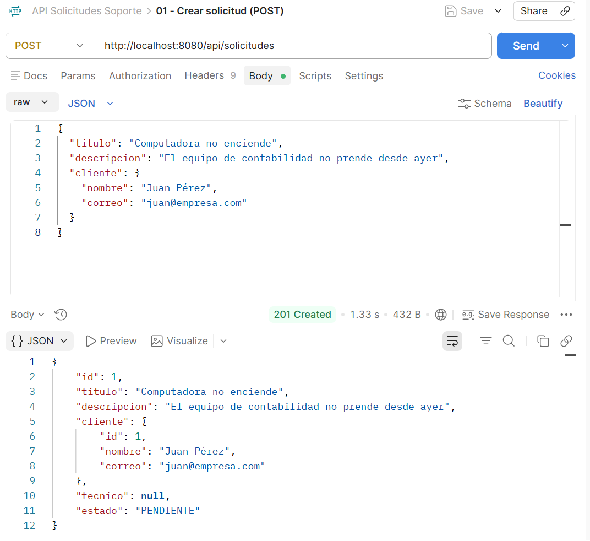 |
| 02 | Listar | 200 | 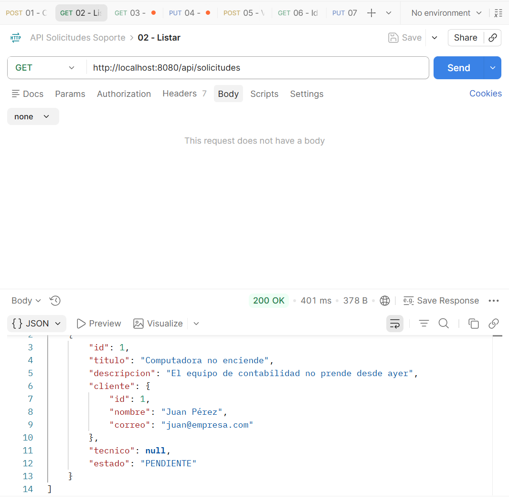 |
| 03 | Buscar por id | 200 | 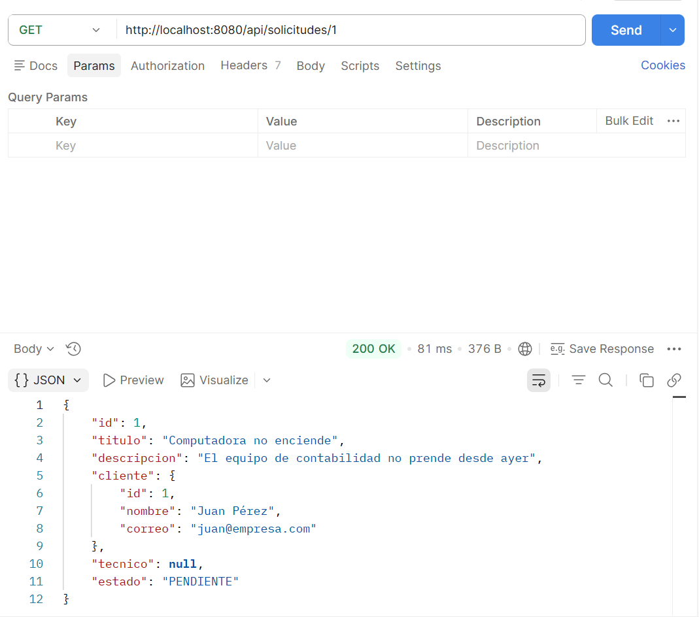 |
| 04 | Actualizar | 200 |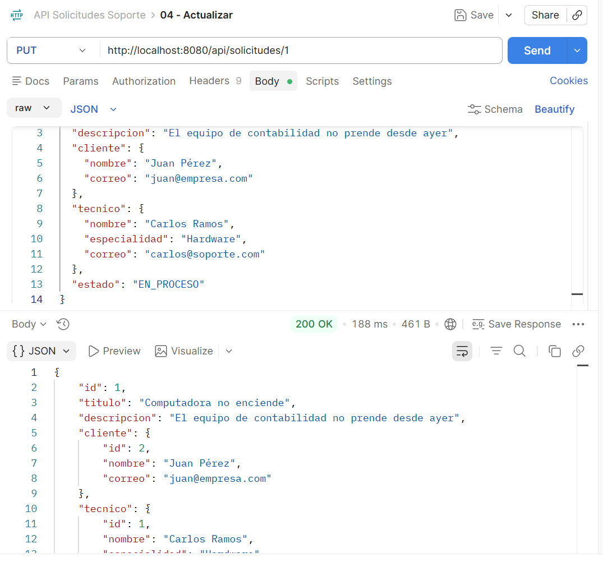 |
| 05 | Validación fallida | 400 | 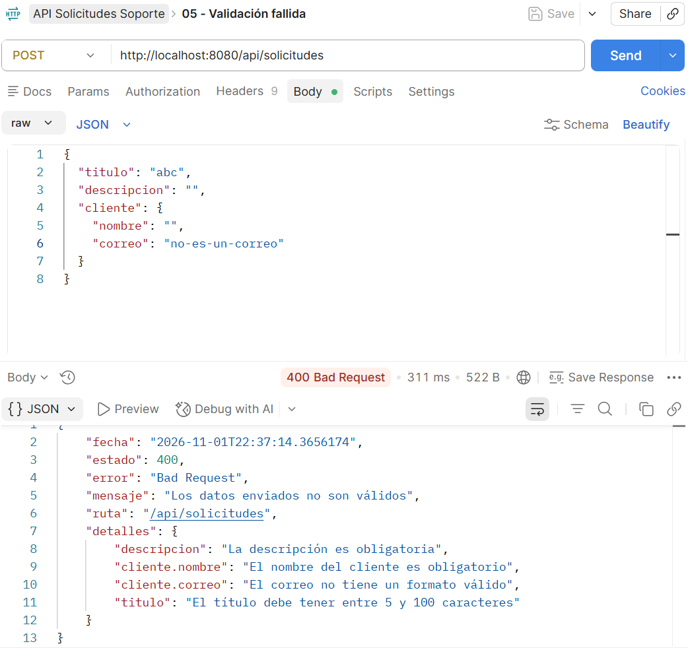 |
| 06 | Id inexistente | 404 |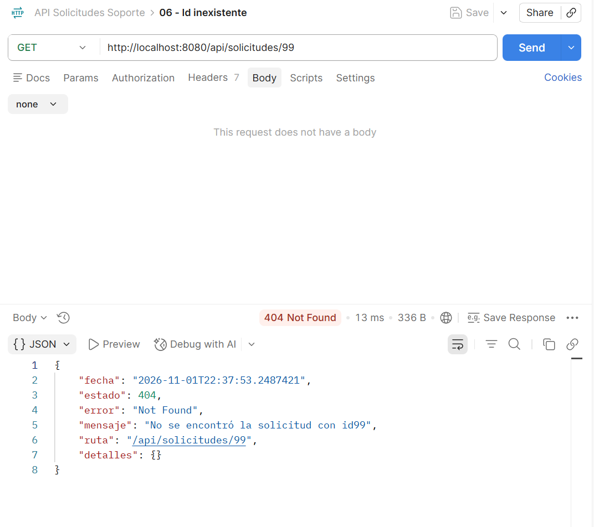 |
| 07 | Regla de negocio | 409 |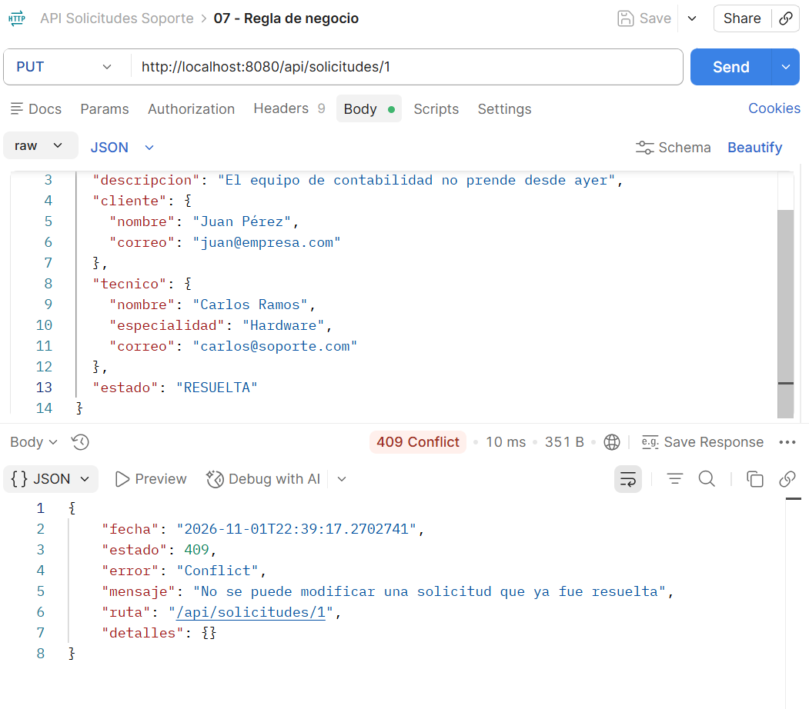|
| 08 | Eliminar | 204 | 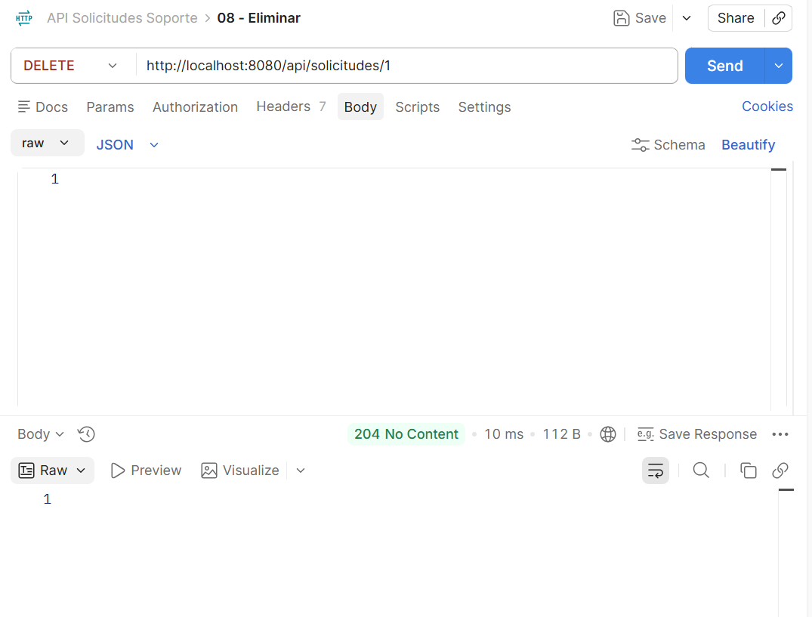 |
| 09 | Verificar eliminación | 404 | 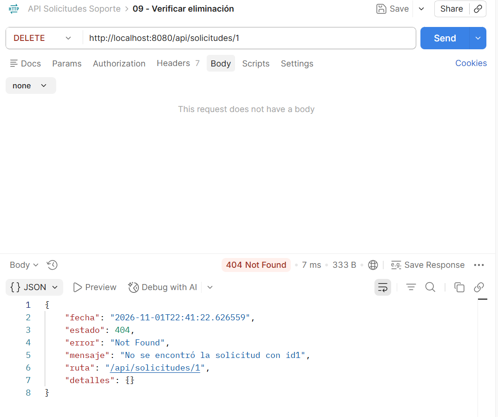|

## Swagger

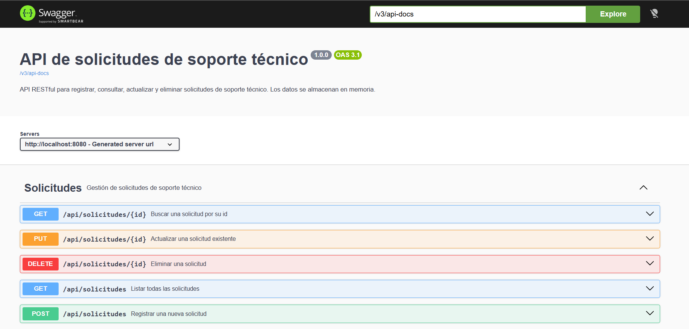

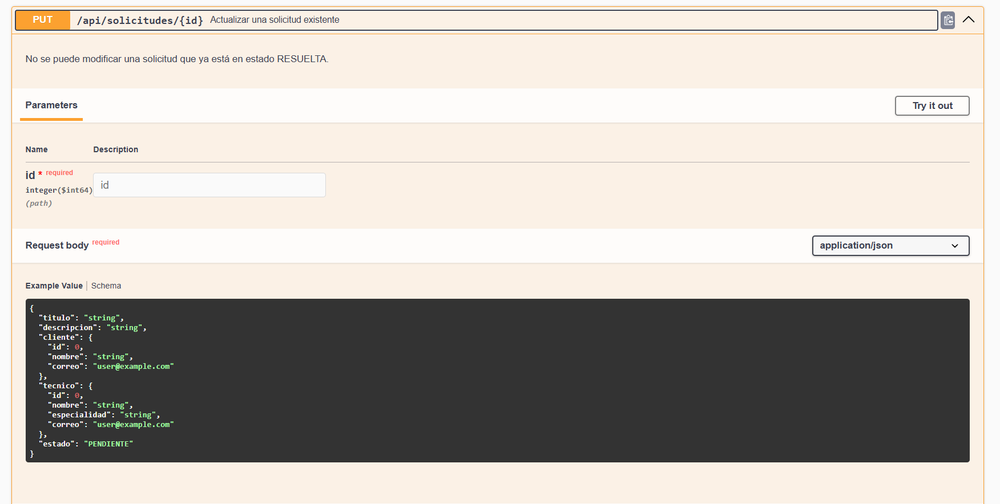
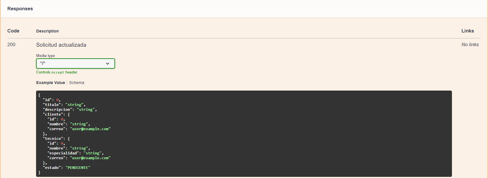
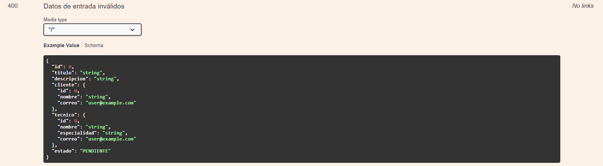
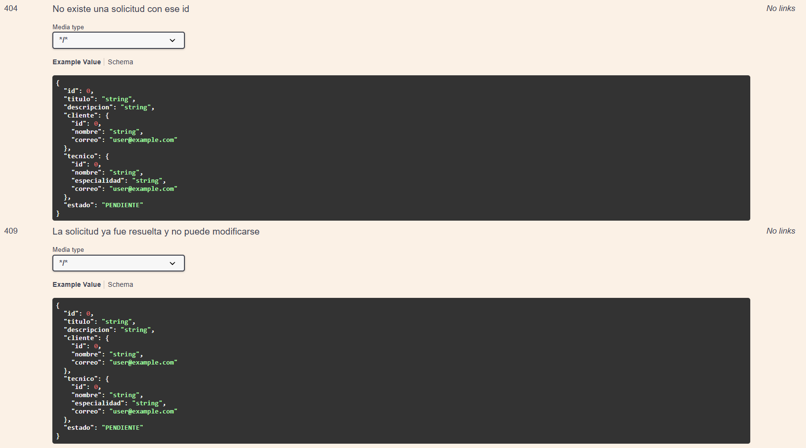

## Roles del equipo

| Integrante       | Rol                                              |
|------------------|--------------------------------------------------|
| Cristhian Moreno | modelo, service, controller, manejo de errores, pruebas Postman y documentación |
